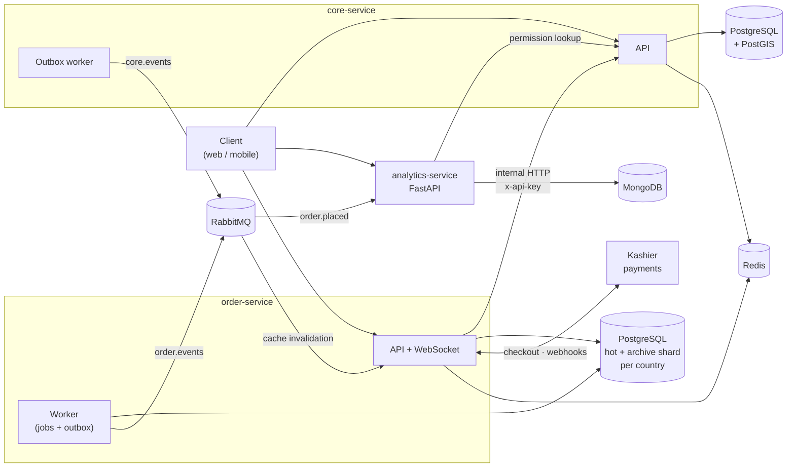

# QuickBite — Food Ordering Platform (Backend)

A backend for a **multi-restaurant food ordering platform**, built as three
independent services that talk over HTTP and RabbitMQ.

Restaurants sign up, open branches, manage a catalogue whose price and stock
vary per branch, and give their staff scoped permissions. Customers find
branches that deliver to them, place orders and pay online or cash on delivery.
Delivery agents are dispatched by proximity, restaurants see their balance and
payouts, and owners get daily analytics.

| Service | Responsibility | Stack |
| --- | --- | --- |
| [`core-service`](core-service/) | Identity, restaurants, branches, products, addresses, RBAC | TypeScript · Express 5 · PostgreSQL + PostGIS · Redis |
| [`order-service`](order-service/) | Orders, payments, delivery dispatch, agents, restaurant finance, archival | TypeScript · Express 5 · sharded PostgreSQL · Redis · socket.io |
| [`analytics-service`](analytics-service/) | Per-day order and revenue rollups for restaurant owners | Python · FastAPI · MongoDB |

All three are implemented. Each one has its own dependencies, migrations,
configuration and README.

## Architecture



- **Synchronous** calls (HTTP) are used only when an answer is needed right
  now: order-service reads branches, prices and stock from core, and reserves
  stock before writing an order.
- **Asynchronous** events (RabbitMQ) carry everything else. Each publisher
  writes events to a **transactional outbox** in the same database transaction
  as the change, and a worker drains it to the broker. Consumers de-duplicate
  by event id and route poison messages to a dead-letter queue.
- All services share one JWT contract, so a token issued by core is accepted
  everywhere.

## Engineering Highlights

**Data & scale**
- Order data **sharded by country** (a hot and an archive PostgreSQL database
  per region), with `orders` **partitioned by month** and a nightly job that
  archives prior years while reads still merge both.
- **PostGIS** geospatial search (`ST_DWithin` + GIST index) for "which branches
  deliver to this address", and a **Redis GEO** index for nearby delivery
  agents.
- Indexes added only for queries that exist, checked with `EXPLAIN`; cursor
  pagination everywhere; money stored as integer minor units.

**Reliability**
- **Idempotency keys** on every order and payment write, backed by Redis and
  PostgreSQL so a retry never reserves stock or charges twice.
- **Saga-style compensation**: stock is reserved in core and released if the
  order write or payment fails.
- **Transactional outbox** on both publishers (`FOR UPDATE SKIP LOCKED`,
  publisher confirms) and at-least-once consumers with dedupe and DLQs.
- Compare-and-set status transitions, so concurrent actions on one order get
  exactly one winner.

**Security**
- JWT access + refresh tokens in `httpOnly` cookies, bcrypt hashing, hashed
  password-reset OTPs with expiry.
- **Two-level RBAC**: system roles plus restaurant roles with `resource:action`
  permissions and branch-level scoping.
- Hashed API keys for service-to-service calls; signature-verified payment
  webhooks.

**Code quality**
- Layered modules (Routes → Controllers → Services → Repositories) with
  dependency injection (`tsyringe` in Node, FastAPI dependencies in Python).
- Infrastructure behind interfaces (cache, email, message broker, payment
  provider), so adapters are swappable.
- Strict TypeScript, `mypy --strict` and `ruff` on the Python service,
  zod/pydantic-validated configuration, structured JSON logs with correlation
  IDs, central typed error handling and graceful shutdown.

## Tech Stack

| Area | Technology |
| --- | --- |
| Languages | TypeScript (Node.js 20+), Python 3.11+ |
| Frameworks | Express 5, FastAPI |
| Databases | PostgreSQL (PostGIS, partitioning, sharding), MongoDB |
| Data access | Knex (query builder + migrations), pymongo |
| Cache / coordination | Redis (cache, idempotency, GEO, locks, socket.io adapter) |
| Messaging | RabbitMQ (topic exchanges, DLQs, publisher confirms) |
| Real-time | socket.io |
| Payments | Kashier v3 |
| Auth | JWT, bcrypt, hashed API keys |
| Validation | zod, class-validator, pydantic |

## Repository Layout

```
foodOrderingApp/
├── core-service/        # Node/TS — identity, catalogue, RBAC, internal API, outbox
├── order-service/       # Node/TS — orders, payments, delivery, finance, archival
│   └── docs/            # system design, API contracts, DB design, business rules
├── analytics-service/   # Python/FastAPI — daily rollups from order events
│   └── docs/
└── docs/                # cross-service development workflow
```

## Running Locally

You need **Node.js 20+, Python 3.11+, PostgreSQL 14+ with PostGIS, Redis,
RabbitMQ and MongoDB**. Start the services in this order — each README has the
full steps and environment variables:

1. **[core-service](core-service/README.md#getting-started)** — `npm run migrate`, `npm run dev`, `npm run worker:dev`
2. **[order-service](order-service/README.md#getting-started)** — `npm run migrate:all`, `npm run dev`, `npm run dev:worker`
3. **[analytics-service](analytics-service/README.md#setup)** — `uv sync`, `python server.py`

Shared settings that must match across services: the JWT `ACCESS_SECRET` /
`REFRESH_SECRET`, and core's `ORDER_SERVICE_API_KEY` = order-service's
`CORE_INTERNAL_API_KEY`.

Docker Compose for the whole stack is in progress.

## Project Status

| Area | Status |
| --- | --- |
| core-service | ✅ Implemented |
| order-service | ✅ All planned phases built and verified against real Postgres, Redis, RabbitMQ and Kashier test mode |
| analytics-service | ✅ Implemented (daily rollups, RBAC-protected API) |
| Docker Compose | 🚧 In progress |
| Automated tests | ⏳ Not started — verification so far is scripted manual checks (see [`order-service/docs/status.md`](order-service/docs/status.md)) |
| OpenAPI docs | ⏳ Planned — endpoints are documented in [`order-service/docs/api-contracts.md`](order-service/docs/api-contracts.md) and [`analytics-service/docs/api-contracts.md`](analytics-service/docs/api-contracts.md) |

## Documentation

- [Development workflow](docs/development-workflow.md) — how a feature is built, layer by layer
- [order-service docs](order-service/docs/README.md) — system design, API contracts, database design, business rules
- [analytics-service system design](analytics-service/docs/system-design.md)
