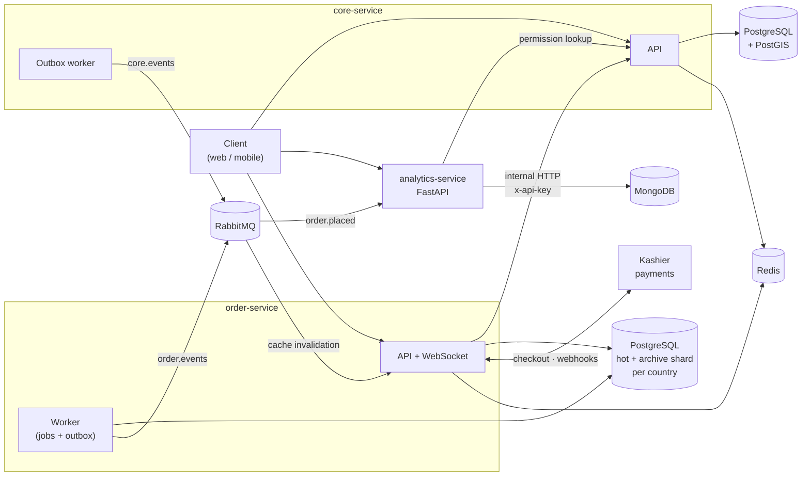
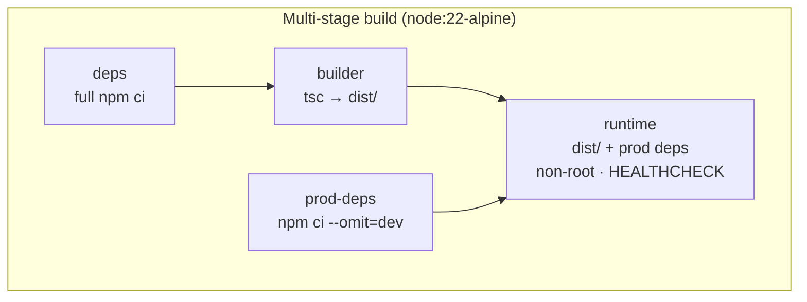
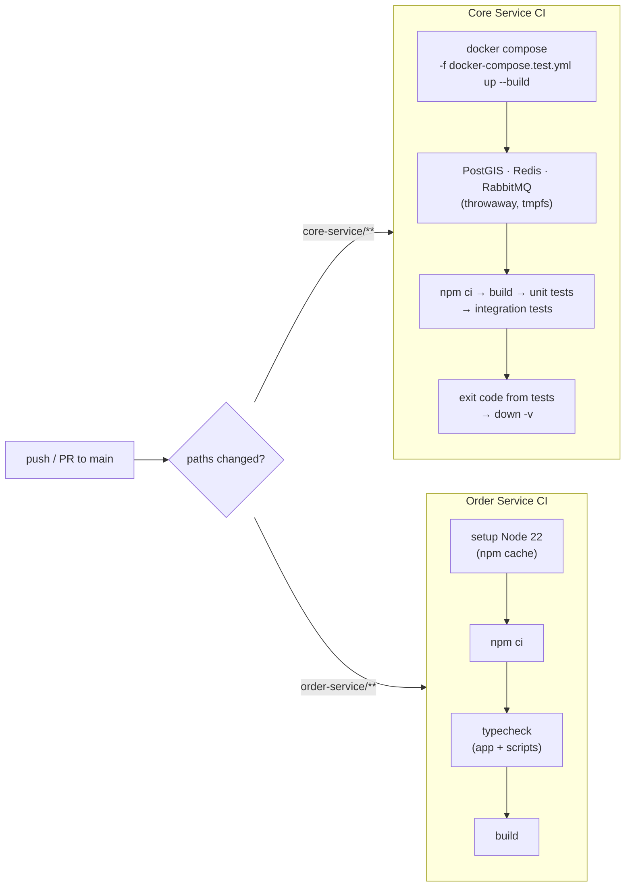

<div align="center">

# 🍔 QuickBite

### A production-style, multi-restaurant food ordering backend

Three independent services · event-driven · sharded · containerized · CI on every push

[](https://github.com/dodmedhat6-glitch/foodOrderingApp/actions/workflows/core-service-ci.yml)
[](https://github.com/dodmedhat6-glitch/foodOrderingApp/actions/workflows/order-service-ci.yml)


[Architecture](#-architecture) ·
[Highlights](#-engineering-highlights) ·
[Docker](#-docker) ·
[CI/CD](#-continuous-integration) ·
[Quick start](#-quick-start) ·
[Docs](#-documentation)

</div>

---

## 📖 Overview

QuickBite is the backend of a **multi-restaurant food ordering platform**,
split into three services that talk over HTTP and RabbitMQ.

Restaurants sign up, open branches, manage a catalogue whose **price and stock
vary per branch**, and give their staff scoped permissions. Customers find the
branches that deliver to them, place orders and pay online or cash on delivery.
Delivery agents are **dispatched by proximity**, restaurants see their balance
and payouts, and owners get **daily analytics**.

| Service | Responsibility | Stack |
| --- | --- | --- |
| 🔐 [`core-service`](core-service/) | Identity, restaurants, branches, products, addresses, RBAC | TypeScript · Express 5 · PostgreSQL + PostGIS · Redis |
| 🛒 [`order-service`](order-service/) | Orders, payments, delivery dispatch, agents, restaurant finance, archival | TypeScript · Express 5 · sharded PostgreSQL · Redis · socket.io |
| 📊 [`analytics-service`](analytics-service/) | Per-day order and revenue rollups for restaurant owners | Python · FastAPI · MongoDB |

Each service owns its database, migrations, configuration, Docker setup and README.

## 🏗 Architecture



- **Synchronous** calls (HTTP) are used only when an answer is needed right
  now: order-service reads branches, prices and stock from core, and reserves
  stock before writing an order.
- **Asynchronous** events (RabbitMQ) carry everything else. Each publisher
  writes events to a **transactional outbox** in the same database transaction
  as the change, and a worker drains it to the broker. Consumers de-duplicate
  by event id and route poison messages to a dead-letter queue.
- All services share one JWT contract, so a token issued by core is accepted
  everywhere.

## ✨ Engineering Highlights

<table>
<tr>
<td width="50%" valign="top">

**🗄 Data & scale**
- Order data **sharded by country** — a hot and an archive PostgreSQL
  database per region.
- `orders` **partitioned by month**; a nightly job archives prior years while
  reads still merge both.
- **PostGIS** search (`ST_DWithin` + GIST) for "who delivers here?", and a
  **Redis GEO** index for nearby delivery agents.
- Cursor pagination everywhere; money stored as integer minor units.

</td>
<td width="50%" valign="top">

**🛡 Reliability**
- **Idempotency keys** on every order and payment write, so a retry never
  reserves stock or charges twice.
- **Saga-style compensation**: stock reserved in core is released if the order
  or payment fails.
- **Transactional outbox** (`FOR UPDATE SKIP LOCKED`, publisher confirms) and
  at-least-once consumers with dedupe and DLQs.
- Compare-and-set status transitions — concurrent actions get exactly one winner.

</td>
</tr>
<tr>
<td valign="top">

**🔐 Security**
- JWT access + refresh tokens in `httpOnly` cookies, bcrypt, hashed reset OTPs.
- **Two-level RBAC**: system roles plus restaurant roles with
  `resource:action` permissions and branch-level scoping.
- Hashed API keys between services; signature-verified payment webhooks.
- Containers run as a non-root user; `.env` never enters a build context.

</td>
<td valign="top">

**🧱 Code quality & DevOps**
- Layered modules (Routes → Controllers → Services → Repositories) with DI
  (`tsyringe` / FastAPI dependencies).
- Infrastructure behind interfaces (cache, email, broker, payments).
- Strict TypeScript, `mypy --strict` + `ruff`, zod/pydantic-validated config.
- **Multi-stage Docker images**, one-command Compose stacks and **GitHub
  Actions CI** with throwaway test infrastructure.

</td>
</tr>
</table>

## 🐳 Docker

Both Node services ship a **multi-stage Dockerfile** and two Compose stacks:
one for development, and a disposable one for tests and CI.



| | core-service | order-service |
| --- | --- | --- |
| **Image targets** | `runner` (default), `migrator`, `test` | `runtime` |
| **Dev stack** — `docker-compose.yml` | PostGIS · Redis · RabbitMQ · `migrate` · API · outbox worker | Postgres (4 shard DBs) · Redis · RabbitMQ · `migrate` · API · worker |
| **Test stack** | `docker-compose.test.yml` — runs the Jest suite and exits | `docker-compose-test.yml` — full stack, no `.env` needed |
| **API port** | `3000` | `3001` |

What makes them solid:

- 🪶 **Lean runtime images** — dev dependencies and the TypeScript toolchain
  never reach the final stage; native addons (bcrypt) are compiled in a
  throwaway stage.
- ⏱ **Ordered startup** — a one-shot `migrate` service brings the schema up to
  date, and the API and worker wait on `service_completed_successfully` plus
  healthchecks for Postgres, Redis and RabbitMQ.
- ❤️ **Real healthchecks** — the image probes `GET /api/health`, which does a
  database round-trip (order-service answers `503` if any shard is down).
  Workers serve no HTTP, so their check is disabled.
- 🧪 **Disposable test stacks** — Postgres and RabbitMQ on `tmpfs`, so every run
  starts from an empty database and leaves nothing behind.
- 🔌 **Side-by-side friendly** — core's dev stack publishes its infra on shifted
  host ports (`5433`, `6380`, `5673`), so both services' stacks run at the same
  time without clashes.

## ⚙ Continuous Integration

Each service has its own **GitHub Actions** workflow, triggered on pushes and
pull requests to `main` that touch that service (plus manual
`workflow_dispatch`).



| Workflow | What it proves |
| --- | --- |
| [`core-service-ci.yml`](.github/workflows/core-service-ci.yml) | The service builds, and the Jest unit **and integration** suites pass against real PostgreSQL/PostGIS, Redis and RabbitMQ — all inside Docker, exactly like a developer runs it locally |
| [`order-service-ci.yml`](.github/workflows/order-service-ci.yml) | Strict type-check of the app and its scripts, then a production build |

## 🚀 Quick start

### Option A — Docker (recommended)

You only need **Docker** with Compose v2.

```bash
# core-service: PostGIS + Redis + RabbitMQ + migrations + API + outbox worker
cd core-service
cp .env.example .env          # set DB_PASSWORD, DB_NAME, JWT secrets, Mailjet, ORDER_SERVICE_API_KEY
docker compose up -d --build
curl http://localhost:3000/api/health

# order-service: Postgres (4 shard DBs) + Redis + RabbitMQ + migrations + API + worker
cd ../order-service
cp .env.example .env          # set DB_eg_PASSWORD, JWT secrets, CORE_INTERNAL_API_KEY, Kashier
docker compose up -d --build
curl http://localhost:3001/api/health
```

Run the core-service test suite the same way CI does:

```bash
cd core-service
docker compose -f docker-compose.test.yml up --build --abort-on-container-exit --exit-code-from tests
docker compose -f docker-compose.test.yml down -v
```

### Option B — Natively

You need **Node.js 20+, Python 3.11+, PostgreSQL 14+ with PostGIS, Redis,
RabbitMQ and MongoDB**. Start the services in this order — each README has the
full steps and environment variables:

1. **[core-service](core-service/README.md#-getting-started)** — `npm run migrate`, `npm run dev`, `npm run worker:dev`
2. **[order-service](order-service/README.md#-getting-started)** — `npm run migrate:all`, `npm run dev`, `npm run dev:worker`
3. **[analytics-service](analytics-service/README.md#setup)** — `uv sync`, `python server.py`

From the repo root, `npm run dev:all` starts both Node APIs and both workers
together.

> [!IMPORTANT]
> Shared settings that must match across services: the JWT `ACCESS_SECRET` /
> `REFRESH_SECRET`, and core's `ORDER_SERVICE_API_KEY` = order-service's
> `CORE_INTERNAL_API_KEY`.

## 🧰 Tech Stack

| Area | Technology |
| --- | --- |
| Languages | TypeScript (Node.js 20+ / 22 in containers), Python 3.11+ |
| Frameworks | Express 5, FastAPI |
| Databases | PostgreSQL 18 (PostGIS, partitioning, sharding), MongoDB |
| Data access | Knex (query builder + migrations), pymongo |
| Cache / coordination | Redis (cache, idempotency, GEO, locks, socket.io adapter) |
| Messaging | RabbitMQ (topic exchanges, DLQs, publisher confirms) |
| Real-time | socket.io |
| Payments | Kashier v3 |
| Auth | JWT, bcrypt, hashed API keys |
| Validation | zod, class-validator, pydantic |
| Testing | Jest (+ SWC), Supertest |
| DevOps | Docker (multi-stage), Docker Compose, GitHub Actions |

## 📁 Repository Layout

```
foodOrderingApp/
├── .github/workflows/   # CI: core-service-ci.yml, order-service-ci.yml
├── core-service/        # Node/TS — identity, catalogue, RBAC, internal API, outbox
│   ├── tests/           # Jest unit + integration suites
│   ├── Dockerfile       # targets: runner · migrator · test
│   └── docker-compose{,.test}.yml
├── order-service/       # Node/TS — orders, payments, delivery, finance, archival
│   ├── docs/            # system design, API contracts, DB design, business rules
│   ├── Dockerfile
│   └── docker-compose{,-test}.yml
├── analytics-service/   # Python/FastAPI — daily rollups from order events
│   └── docs/
└── docs/                # cross-service development workflow
```

## 📌 Project Status

| Area | Status |
| --- | --- |
| core-service | ✅ Implemented |
| order-service | ✅ All planned phases built and verified against real Postgres, Redis, RabbitMQ and Kashier test mode |
| analytics-service | ✅ Implemented (daily rollups, RBAC-protected API) |
| Docker | ✅ Multi-stage images + dev and test Compose stacks for core-service and order-service |
| CI | ✅ GitHub Actions for core-service (Dockerized tests) and order-service (typecheck + build) |
| Automated tests | 🚧 Jest unit + integration harness running in CI for core-service; coverage is growing. order-service is verified with scripted checks (see [`status.md`](order-service/docs/status.md)) |
| Full-platform Compose | ⏳ Planned — one stack for all three services |
| analytics-service Docker / CI | ⏳ Planned |
| OpenAPI docs | ⏳ Planned — endpoints are documented in [`order-service`](order-service/docs/api-contracts.md) and [`analytics-service`](analytics-service/docs/api-contracts.md) API contracts |

## 📚 Documentation

- [Development workflow](docs/development-workflow.md) — how a feature is built, layer by layer
- [order-service docs](order-service/docs/README.md) — system design, API contracts, database design, business rules
- [analytics-service system design](analytics-service/docs/system-design.md)

<div align="center">

---

Built by **AbdAlrhman Medhat** · backend engineering portfolio project

</div>
