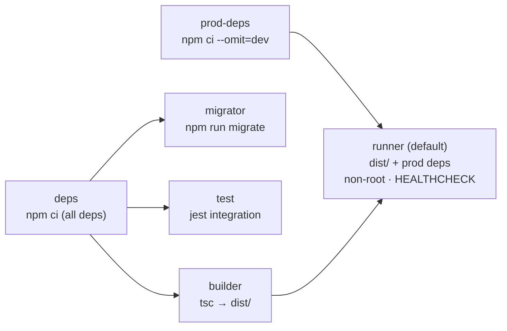
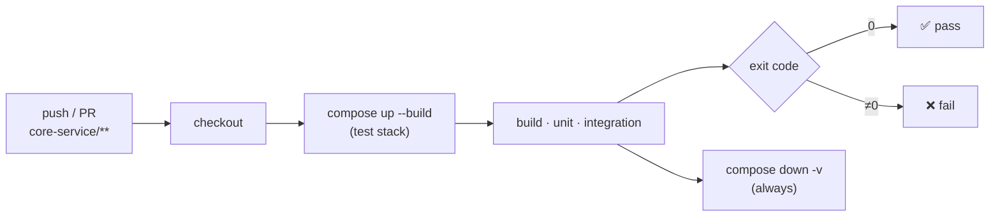

<div align="center">

# 🔐 core-service

**Identity, catalogue and permissions for the QuickBite platform**

[](https://github.com/dodmedhat6-glitch/foodOrderingApp/actions/workflows/core-service-ci.yml)


[← Platform overview](../README.md) ·
[Getting started](#-getting-started) ·
[Docker](#-docker) ·
[Testing & CI](#-testing--ci)

</div>

---

The identity and catalogue service of the platform. Every other service depends
on the data it owns: users, restaurants, branches, products, delivery addresses
and permissions.

**Stack:** Node.js · TypeScript (strict) · Express 5 · PostgreSQL + PostGIS ·
Knex · Redis · RabbitMQ · tsyringe · zod · Mailjet · Jest · Docker

## What it does

| Area | What is implemented |
| --- | --- |
| Authentication | Register (customer or restaurant owner), login, refresh, staff invite acceptance. bcrypt hashing, JWT access + refresh tokens in `httpOnly` cookies. |
| Password reset | 6-digit OTP from `crypto.randomInt`, stored as a SHA-256 hash with a 10-minute expiry, sent through Mailjet. The endpoint requires an `Idempotency-Key` and never reveals whether an account exists. |
| Users | Profile read and update, system roles. |
| Restaurants | Created as `pending` at owner sign-up. Public listing with cursor pagination and filters; status changes by a system admin. |
| Branches | Location, opening hours, delivery radius, fees and commission. PostGIS "who delivers here?" search, cached in Redis. |
| Products | Categories, products, and per-branch price / stock / availability kept in step by a PostgreSQL trigger. |
| Addresses | Customer delivery addresses with a single default per user. |
| RBAC | System roles + restaurant-scoped roles with `resource:action` permissions, member → branch scoping, in-process permission cache. |
| Internal API | `/api/internal/*` for other services (branch, product, stock reserve/release, address, user lookups), protected by hashed API keys. |
| Events | Transactional outbox: domain changes are written to `event_outbox` in the same transaction and drained to RabbitMQ (`core.events`) by a separate worker. |
| Health | `GET /api/health` runs a database round-trip. |

## Highlights

- **Layered modules** (Routes → Controllers → Services → Repositories) wired by
  `tsyringe` dependency injection.
- **Two-level authorization**: system roles plus restaurant roles stored as
  `resource:action` pairs, with branch-level scoping carried in the token so
  most checks need no database hit.
- **Geospatial search** with a PostGIS `geography` column, a GIST index and
  `ST_DWithin`.
- **Transactional outbox** for reliable event publishing to RabbitMQ.
- **Redis** response-cache and idempotency-key middleware.
- **Transactional writes**: restaurant sign-up creates the user, restaurant and
  owner membership in one Knex transaction.
- **Cursor pagination** and whitelisted query filters (`eq`, `gt`, `lt`, `gte`,
  `lte`, `in`, `like`).
- **Swappable infrastructure** behind interfaces (`ICacheProvider`,
  `IEmailProvider`, message broker).
- **Operational basics**: correlation IDs, structured JSON logs with redaction,
  typed central error handling, zod-validated environment, `helmet`, CORS,
  graceful shutdown.

## Architecture

Each module under `src/app/<module>/` is split into layers, and
each layer calls only the one directly below it:

```
Route        routes.ts     HTTP method + path, middleware chain (authenticate, rbac, cache)
  ↓
Controller   controller/   validates the body into a DTO, calls the service, shapes the response
  ↓
Service      service/      business rules, ownership checks, transactions
  ↓
Repository   repository/   Knex queries, maps snake_case rows to entity classes
  ↓
PostgreSQL
```

Alongside the layers, `dto/` holds `class-validator` input classes, `entity/`
holds classes that represent table rows, and `errors.ts` / `enums.ts` hold
module-specific errors and enums.

**Dependency injection.** Tokens are `Symbol.for(...)` values in
`src/lib/di/tokens.ts`. `src/lib/di/containers.ts` registers every controller
and service as a singleton and binds the infrastructure adapters as instances:
`CacheProvider` (Redis) and `EmailProvider` (Mailjet). Classes are marked
`@injectable()` and receive dependencies through `@inject(token)`. For example,
`AuthService` gets `UserService`, `RestaurantService`, `MemberService` and the
`IEmailProvider` through its constructor. Route files resolve their controller
from the container, and the middleware resolves the cache provider the same
way, so changing an adapter only touches the container.

## Core Modules

| Module | Responsibility |
| --- | --- |
| `auth` | Registration (customer / restaurant owner), login, token refresh, password reset by OTP, staff invite acceptance, email template |
| `user` | User accounts, system roles, profile read/update |
| `restaurant` | Restaurant records, lifecycle status (`pending`, `active`, `suspended`, `disable`), paginated public listing |
| `branch` | Branches with location, opening hours, currency, delivery radius and commission. Nearby search |
| `product` | Categories, products, and per-branch price / stock / availability |
| `addresses` | Customer delivery addresses with a single default address per user |
| `rbac` | Roles, permissions, restaurant members, member-branch assignments, permission cache |
| `internal` | Service-to-service endpoints for order-service (API-key protected) |
| `outbox` | `event_outbox` table and the drain service used by `src/worker.ts` |
| `health` | Database connectivity check |

## Shared Infrastructure

`src/lib/` holds application wiring:

| Path | Purpose |
| --- | --- |
| `config/env.ts` | Loads `.env` and validates it with a zod schema. Exposes a typed `env` object. |
| `di/` | `tsyringe` tokens and container bindings |
| `knex/` | Knex config (shared by the app and the Knex CLI) and the database instance |
| `auth/` | `authenticate`, `rbac()`, `requireRestaurantMember()`, `requireBranchAccess()`, cookie helpers |
| `cache/` | Redis provider instance and the `withCache()` response-cache middleware |
| `Idempotency/` | `idempotency()` middleware that stores responses under the `Idempotency-Key` header |
| `error/` | `AppError` (status code + operational flag) and the central error handler |
| `correlationId/` | Assigns a UUID to each request and returns it in `X-Correlation-ID` |
| `logger/` | Structured JSON logger |
| `http/` | Response envelope helpers, cursor pagination and query-filter parsing |
| `validation/` | `validateBody()` built on `class-transformer` + `class-validator` (whitelisting) |
| `email/` | Mailjet provider instance |

`src/pkg/` holds infrastructure adapters behind interfaces, with no
application dependencies:

- `cache/`: `ICacheProvider` and a `RedisCacheProvider` (ioredis)
- `email/`: `IEmailProvider` and a Mailjet provider
- `utils/`: time-unit helpers

## Key Backend Features

### Authentication

- Passwords are hashed with bcrypt.
- Login and registration issue an access token and a refresh token, signed with
  separate secrets and expiries (`ACCESS_EXPIRATION`, `REFRESH_EXPIRATION`).
- Both tokens are set as `httpOnly` cookies (`secure` in production). The
  refresh cookie is scoped to `/api/auth/refresh`, so the browser sends it only
  to that endpoint.
- The token payload carries the user's system role. Restaurant staff tokens also
  carry their restaurant, restaurant role and assigned branches, so
  authorization checks do not need a database lookup per request.
- `POST /api/auth/refresh` verifies the refresh token and issues a new access
  token. The refresh token itself is not rotated.
- Password reset sends a 6-digit OTP by email. Only its SHA-256 hash is stored,
  and it expires after 10 minutes.

### RBAC

Authorization has two levels.

1. **System roles** on the user: `system_admin`, `restaurant_user`, `customer`,
   `delivery_agent`.
2. **Restaurant roles** for `restaurant_user` accounts. A user joins a
   restaurant through `restaurant_members` with a role. `role_permissions` maps
   roles to `(resource, action)` permissions such as `core:product:create`.
   `member_branches` limits a member to specific branches.

Routes compose three middleware:

```ts
branchRouter.patch('/branches/:branchId',
    authenticate,                                      // verify access-token cookie
    requireBranchAccess('branchId'),                   // branch is in the token's branchIds
    rbac({resource: "core:branch", action: 'update'}), // role has the permission
    branchController.update
);
```

- `requireRestaurantMember` and `requireBranchAccess` let a `system_admin`
  through and check every other user against the restaurant or branches in
  their token.
- `rbac()` looks up the permission set for the user's restaurant role through
  `PermissionsCashService`. This is an in-process cache with a 1-hour TTL, so
  each process queries the database at most once an hour per role.
- On top of the middleware, services enforce ownership (for example, only the
  restaurant owner or a system admin can update a branch). Status changes on
  restaurants and branches are restricted to system admins.
- Owners are created automatically when they sign up. Other staff are invited:
  a user account and an `inactive` membership are created with branch
  assignments and an OTP. `POST /api/auth/accept-invite` then sets the password
  and activates the membership.

### Multi-Branch Product Model

A product belongs to a restaurant, but its commercial data belongs to a branch.
`product_branch_details` holds `price`, `stock` and `is_available` per
`(branch_id, product_id)`, with a unique constraint on the pair. The same burger
can cost and stock differently in each branch, or be unavailable in one of them.

The `trg_product_after_insert` trigger (`fn_insert_product_branch_details`)
runs after each product insert. It creates a row for every existing branch of
that restaurant, with price `0`, stock `0` and `is_available = false`. A new
product therefore starts hidden everywhere until a branch prices and enables
it. The trigger does not run when a branch is added, so branches created later
get no rows for existing products.

### Observability and Reliability

- **Correlation IDs:** every request gets a UUID, returned in the
  `X-Correlation-ID` response header and attached to error logs.
- **Centralized errors:** modules throw `AppError` instances with an HTTP
  status. The global handler logs every error and returns operational errors as
  is. Anything unexpected becomes a generic `500`, so internal details do not
  leak. All responses use the same `{ success, data, meta? }` envelope.
- **Logging:** a structured JSON logger (level, message, timestamp, metadata)
  writes to stdout.
- **Health check:** `GET /api/health` runs a database round-trip.
- **Environment validation:** the zod schema runs at import time. A missing
  required variable stops the process at startup, not on the first request
  that needs it.
- **Graceful shutdown:** on `SIGINT`/`SIGTERM` the HTTP server stops accepting
  connections, then the Knex pool is closed.

## Tech Stack

| Area | Technology |
| --- | --- |
| Runtime / language | Node.js 20+, TypeScript (strict mode) |
| HTTP | Express 5 |
| Database | PostgreSQL with PostGIS, Knex (query builder + migrations), `pg` |
| Cache | Redis via ioredis |
| Messaging | RabbitMQ via amqplib + amqp-connection-manager |
| DI | tsyringe, reflect-metadata |
| Validation | zod (environment), class-validator + class-transformer (DTOs) |
| Auth | jsonwebtoken, bcrypt, cookie-parser |
| Email | Mailjet |
| Security | helmet, cors |
| Testing | Jest + SWC, Supertest |
| Containers / CI | Docker (multi-stage), Docker Compose, GitHub Actions |

## 🚀 Getting Started

The fastest way is [Docker](#-docker) — one command brings up PostGIS, Redis,
RabbitMQ, the migrations, the API and the worker. To run it natively instead:

### Prerequisites

- Node.js 20+
- PostgreSQL 14+ with the **PostGIS** extension available (the branches
  migration runs `CREATE EXTENSION IF NOT EXISTS postgis`)
- Redis 6+
- RabbitMQ (only needed for the outbox worker)
- Mailjet credentials to actually send emails (any non-empty value boots the
  server)

### Run it

```bash
cd core-service
npm install
cp .env.example .env      # fill in DB, JWT secrets, Mailjet, ORDER_SERVICE_API_KEY
npm run migrate           # renames legacy migrations if needed, then migrate:latest
npm run dev               # API on PORT (default 3000), under /api
npm run worker:dev        # outbox worker → RabbitMQ (separate terminal)
```

Check it:

```bash
curl http://localhost:3000/api/health
# {"success":true,"data":{"status":"ok"}}
```

### Scripts

| Script | Description |
| --- | --- |
| `npm run dev` | API with `tsx watch` |
| `npm run worker:dev` | Outbox worker with `tsx watch` |
| `npm run build` / `npm start` / `npm run worker` | Compile with `tsc` and run from `dist/` |
| `npm run migrate` | Fix legacy migration names, then `migrate:latest` |
| `npm run knex -- <cmd>` | Any Knex CLI command (`migrate:list`, `migrate:rollback`, …) |
| `npm test` | Jest unit tests (`tests/unit`) |
| `npm run test:integration` | Jest integration tests against a real database (`tests/integration`) |
| `npm run test:watch` | Unit tests in watch mode |

## 🐳 Docker

One multi-stage [`Dockerfile`](Dockerfile) (`node:22-alpine`) produces every
image the service needs:



| Target | Used for |
| --- | --- |
| `runner` | Production image: compiled `dist/` and production dependencies only, runs as `node`, healthcheck on `/api/health`. Also runs the outbox worker (`node dist/worker.js`). |
| `migrator` | One-shot schema migration job. Keeps `src/` because migrations are `.ts` files run through `tsx`. |
| `test` | The Jest suite, run against throwaway infrastructure. |

bcrypt is a native addon, so the dependency stages carry a compiler — but
`runner` only copies an already-built `node_modules`, so no toolchain ships.
`.dockerignore` keeps `.env` out of the build context entirely.

### Development stack — `docker-compose.yml`

```bash
cp .env.example .env              # DB_PASSWORD and DB_NAME are required
docker compose up -d --build
docker compose logs -f core-service
curl http://localhost:3000/api/health
```

| Service | What it is | Host port |
| --- | --- | --- |
| `postgres` | `postgis/postgis:18-3.6` — the PostGIS extension is enabled automatically | `5433` |
| `redis` | `redis:7-alpine` | `6380` |
| `rabbitmq` | `rabbitmq:3.13-management-alpine` (UI at http://localhost:15673) | `5673`, `15673` |
| `migrate` | One-shot `migrator` job; exits when the schema is current | — |
| `core-service` | The API | `3000` |
| `core-worker` | Outbox worker draining `event_outbox` to RabbitMQ | — |

- The API and worker start only after Postgres, Redis and RabbitMQ are
  **healthy** and `migrate` has **completed successfully**.
- Infra host ports are deliberately **shifted off the defaults** so this stack
  runs next to order-service's (which uses `5432`/`6379`/`5672`) or a native
  Postgres. Override them in `.env` with `PG_HOST_PORT`, `REDIS_HOST_PORT`,
  `RABBITMQ_HOST_PORT`, `RABBITMQ_UI_PORT`, `API_HOST_PORT`.
- Mailjet is the only external dependency — `MAILJET_*` must be real (or
  sandbox) credentials for the password-reset email to actually send.

## 🧪 Testing & CI

Tests live in [`tests/`](tests/) and run on **Jest with the SWC transformer**:

| Suite | Config | Runs |
| --- | --- | --- |
| Unit | `jest.config.js` | `tests/unit/**/*.test.ts` — pure logic, no I/O |
| Integration | `jest.integration.config.js` | `tests/integration/**/*.integration.test.ts` — the real Express app via Supertest, against PostgreSQL/PostGIS with migrations applied in `globalSetup` and the email provider stubbed |

### Run the whole suite in Docker

[`docker-compose.test.yml`](docker-compose.test.yml) is a self-contained,
throwaway stack: its own project name, **no published ports** (so it never
collides with a running dev stack) and Postgres on **tmpfs**, so every run
starts from an empty database and leaves nothing behind.

```bash
docker compose -f docker-compose.test.yml up --build --abort-on-container-exit --exit-code-from tests
docker compose -f docker-compose.test.yml down -v
```

The `tests` container runs `npm ci → npm run build → npm test → npm run
test:integration`, and its exit code becomes the command's exit code.

### GitHub Actions

[`.github/workflows/core-service-ci.yml`](../.github/workflows/core-service-ci.yml)
runs **that exact command** on every push and pull request to `main` that
touches `core-service/**`, then tears the stack down with `down -v` even if the
tests fail. CI and a developer's machine therefore run the same containers —
no "works on my machine" gap.



## Known Issues

- **Old databases:** two migrations were renamed so a fresh database builds
  cleanly. Always use `npm run migrate` (not raw `knex migrate:latest`), which
  rewrites the old names in `knex_migrations` first.
- Staff invitation OTPs are logged, not emailed yet.
- Refresh tokens are not rotated or revocable; reset OTPs are not single-use.
- The `product_branch_details` trigger runs on product insert only, so a branch
  created later gets no rows for existing products.
- Test coverage is still small: the harness and CI are in place, and suites are
  being added module by module.

## Roadmap

- [x] Docker images and Compose stacks for development and tests
- [x] Jest unit + integration harness, running in CI
- [ ] Broaden test coverage across every module
- [ ] Send invitation emails; make reset OTPs single-use (`consumed_at`)
- [ ] Rotate and revoke refresh tokens
- [ ] Reuse an incoming correlation ID when one is provided
- [ ] OpenAPI documentation

See also: [development workflow](../docs/development-workflow.md).
