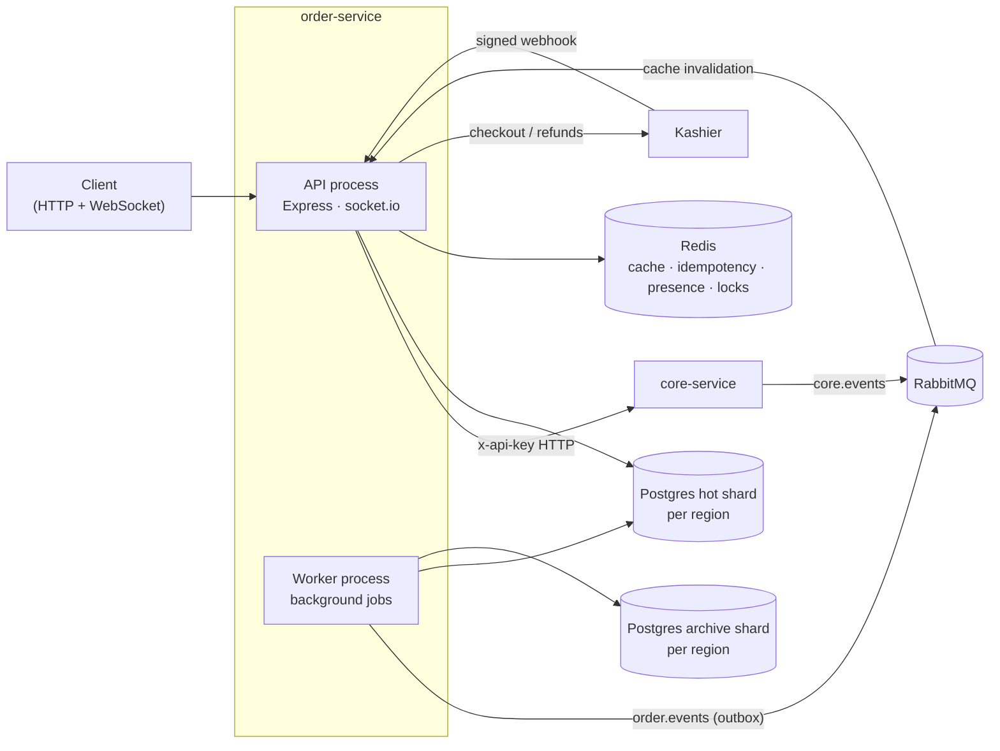
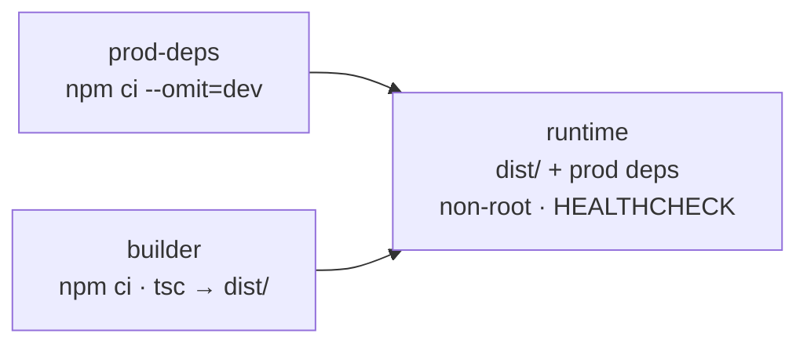
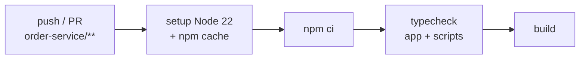

<div align="center">

# 🛒 order-service

**Orders, payments, dispatch and finance for the QuickBite platform**

[](https://github.com/dodmedhat6-glitch/foodOrderingApp/actions/workflows/order-service-ci.yml)


[← Platform overview](../README.md) ·
[Getting started](#-getting-started) ·
[Docker](#-docker) ·
[CI](#-continuous-integration) ·
[Full docs](docs/README.md)

</div>

---

Everything that happens after a customer picks their food: **orders, payments,
delivery dispatch, delivery agents, restaurant finance and archival** of old
data. Users, restaurants, branches, products and permissions live in
[`core-service`](../core-service/); this service reads them from there.

**Stack:** Node.js · TypeScript · Express 5 · PostgreSQL (sharded + partitioned)
· Knex · Redis · RabbitMQ · socket.io · Kashier payments · tsyringe · zod ·
Docker · GitHub Actions

## What it does

| Module | What is implemented |
| --- | --- |
| Orders | Placement with stock reservation in core (and compensation on failure), a status machine with compare-and-set transitions, customer / restaurant / agent views, monthly table partitions. |
| Payments | Kashier v3 hosted checkout, signed webhooks, cash on delivery, manual and automatic refunds, expiry of unpaid orders with stock released. |
| Delivery | Offer-and-claim dispatch to nearby agents with an escalating search radius; race-safe claiming. |
| Agents | Live presence in a Redis GEO index with heartbeat expiry; per-delivery earnings. |
| Restaurant finance | Balances, payouts and a ledger summary per restaurant, all in integer minor units. |
| Archival | Nightly move of prior-year orders (with their children) to an archive database, with merged reads across hot and archive data. |
| Real-time | socket.io rooms per customer, restaurant, branch, agent and admin; Redis adapter so any process can publish. |
| Events | Consumes `core.<entity>.invalidated` from RabbitMQ to keep cached core data fresh; publishes `order.placed` through a transactional outbox for analytics-service. |

## Engineering Highlights

- **Database sharding by country**: each region (`eg`, `sa`, …) has its own hot
  database plus an archive database, selected per request by the `X-Region`
  header. Nothing queries across shards.
- **Native PostgreSQL partitioning**: `orders` is partitioned by month and a
  worker job creates upcoming partitions.
- **Idempotency** on every order and payment write (Redis + Postgres), so a
  retried request never reserves stock or charges twice.
- **Saga-style compensation**: stock is reserved in core before the order is
  written and released if anything fails afterwards.
- **Concurrency safety**: status changes are compare-and-set; payouts and
  agent claims were tested under concurrent requests.
- **Transactional outbox** drained with `FOR UPDATE SKIP LOCKED` and publisher
  confirms; inbound events are de-duplicated by event id with a dead-letter
  queue for bad messages.
- **Payment security**: webhook signature verification, duplicate and forged
  webhook handling, provider hidden behind an `IPaymentProvider` interface.
- **Two processes, one codebase**: a horizontally scalable API and a worker
  whose jobs are all safe to run twice (archival takes a Redis lock).
- **Money as integers** in minor units (piasters, halalas) everywhere.

## Architecture



### Worker jobs

| Job | Every | Does |
| --- | --- | --- |
| `order:partition-maintenance` | 24h | Creates the next 3 monthly `orders` partitions |
| `payment:expiry-sweep` | 60s | Cancels unpaid online orders past expiry and returns stock |
| `delivery:assignment-sweep` | 15s | Offers unclaimed orders to nearby agents |
| `agent:presence-sweep` | 60s | Removes stale agents from the geo index |
| `archival:nightly` | 1h (02:00–05:00 only) | Moves prior-year data to the archive shard |
| `outbox drain` | 2s | Publishes `order.placed` events to RabbitMQ |
| `idempotency:purge-expired` | 1h | Deletes expired idempotency records |

### Order lifecycle

```
pending_payment ─(paid)─> placed ─> accepted ─> preparing ─> ready ─> assigned ─> picked ─> delivered
      │                     │  └─> rejected        │           │         │
      └─> cancelled         └─> cancelled          └─> cancelled └─> cancelled (unclaim → ready)
```

Who may move which edge, and the side effects of each transition (refunds,
stock release, dispatch, settlement), are in
[`docs/business-logic/orders.md`](docs/business-logic/orders.md).

## 🚀 Getting Started

The quickest route is [Docker](#-docker): one command gives you Postgres with
all four shard databases, Redis, RabbitMQ, the migrations, the API and the
worker. To run it natively:

### Prerequisites

- Node.js 20+
- PostgreSQL 14+ (one hot and one archive database per region in `REGIONS`)
- Redis 6+
- RabbitMQ
- A running [`core-service`](../core-service/) — its `ORDER_SERVICE_API_KEY`
  must equal this service's `CORE_INTERNAL_API_KEY`, and the JWT secrets must
  match
- Kashier test credentials for online payments (COD works without them)

### Run it

```bash
cd order-service
npm install
cp .env.example .env                               # DB per region, Redis, RabbitMQ, core, Kashier
npm run migrate:all                                # every region's hot shard
npx tsx src/migrate.ts --cluster=all                # or: both clusters, every region, in one pass
npm run dev                                        # API (HTTP /api + WebSocket /ws)
npm run dev:worker                                 # background jobs (separate terminal)
```

### Scripts

| Script | Description |
| --- | --- |
| `npm run dev` / `npm run dev:worker` | API / worker with `tsx watch` |
| `npm run build`, `npm start`, `npm run start:worker` | Compile and run from `dist/` |
| `npm run typecheck` | Type-check app and scripts |
| `npm run migrate:all` | Migrate every region's shard |
| `npm run archive:now` | Run archival immediately (ignores the night window) |

## 🐳 Docker

A three-stage [`Dockerfile`](Dockerfile) on `node:22-alpine`:



- `npm ci` runs **twice** — with dev deps to build, without them to ship —
  instead of `npm prune`, so nothing removed lingers in a layer.
- No build toolchain: every production dependency is pure JS or ships a musl
  prebuild.
- The **same image** runs the API (`dist/server.js`), the worker
  (`dist/worker.js`) and the migrations (`dist/migrate.js`). Migrations run from
  the compiled `dist/migrations`, since the image has no `src/` and no `tsx`.
- Runs as the unprivileged `node` user. The healthcheck hits `/api/health`,
  which answers `503` when any shard is unreachable — unhealthy means "cannot
  serve", not just "process is alive".

### Development stack — `docker-compose.yml`

```bash
cp .env.example .env              # DB_eg_PASSWORD is required
docker compose up -d --build
docker compose logs -f order-service
curl http://localhost:3001/api/health
```

| Service | What it is | Host port |
| --- | --- | --- |
| `postgres` | `postgres:18` — an init script creates all **four shard databases** (hot + archive for `eg` and `sa`) in one cluster | `5432` |
| `redis` | `redis:7-alpine`, `requirepass` set from `REDIS_PASSWORD` when it is non-empty | `6379` |
| `rabbitmq` | `rabbitmq:3.13-management-alpine` (UI at http://localhost:15672) | `5672`, `15672` |
| `migrate` | One-shot `node dist/migrate.js --cluster=all` — every region, hot and archive | — |
| `order-service` | API (HTTP `/api` + WebSocket) | `3001` |
| `order-worker` | Background jobs + outbox drain | — |

It reads the same `.env` as `npm run dev` and overrides only what differs
inside the network (hosts, ports, migration paths). `POSTGRES_PASSWORD` comes
from `DB_eg_PASSWORD`, so the cluster and the app can never drift apart. The
API and worker wait for healthy infra **and** a successful `migrate`.

### Test stack — `docker-compose-test.yml`

A disposable stack for verification runs and CI, built so that it runs on a
machine that has never been set up:

- 🧾 **No `.env`** — every variable the zod config requires is inline; anything
  you may want to point elsewhere (core-service, Kashier) is `${VAR:-default}`.
- 💾 **tmpfs storage** — Postgres and RabbitMQ start empty every run, so init SQL
  and migrations always execute; Postgres runs with `fsync=off` for speed.
- ⏩ **Fast timers** — sweeps, drains, offer TTLs and the archival window are
  shortened so tests don't wait on production cadences.
- 🔌 **Shifted host ports** (`15432`, `16379`, `15673`, API on `3101`) so it
  runs alongside the dev stack without touching its data.

```bash
docker compose -f docker-compose-test.yml up --build -d
docker compose -f docker-compose-test.yml logs -f order-service
docker compose -f docker-compose-test.yml down -v

# infrastructure only, for driving the play/ scripts from the host:
docker compose -f docker-compose-test.yml up -d postgres redis rabbitmq migrate
```

## ⚙ Continuous Integration

[`.github/workflows/order-service-ci.yml`](../.github/workflows/order-service-ci.yml)
runs on every push and pull request to `main` that touches `order-service/**`
(and on demand via `workflow_dispatch`):



`npm run typecheck` checks both the application (`tsconfig.json`) and the
operational scripts (`tsconfig.scripts.json`), so a broken script fails the
build too.

## Documentation

| Doc | Covers |
| --- | --- |
| [system-design.md](docs/system-design.md) | Processes, databases, Redis, RabbitMQ, WebSocket, core integration |
| [api-contracts.md](docs/api-contracts.md) | Every endpoint, who can call it, errors, WebSocket events |
| [database-design.md](docs/database-design.md) | Tables, keys, indexes, partitioning |
| [status.md](docs/status.md) | What each phase delivered, how it was verified, known limits |
| [business-logic/](docs/business-logic/) | Orders, payments, deliveries, agents, finance, archival, permissions |

## Verification

CI guards types and the build; behaviour is not yet covered by an automated
test suite. Each phase was verified with local scripts against real Postgres,
Redis, RabbitMQ and Kashier's test environment (now runnable on the throwaway
[test stack](#test-stack--docker-compose-testyml)) —
for example 48 finance checks including concurrent payouts, and 32 archival
checks over 5,000 orders including crash recovery. Details and known limits:
[`docs/status.md`](docs/status.md).
