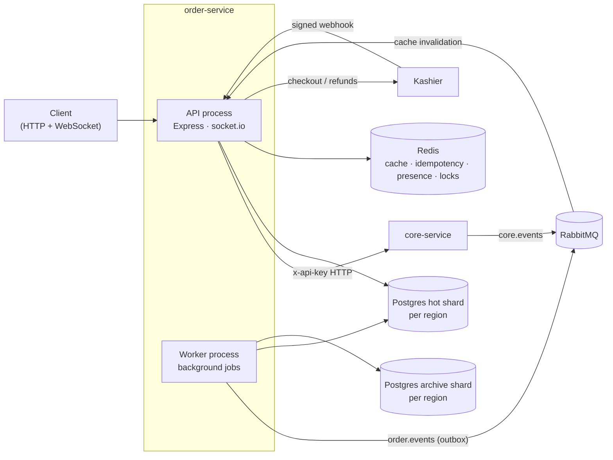

# order-service

Everything that happens after a customer picks their food: **orders, payments,
delivery dispatch, delivery agents, restaurant finance and archival** of old
data. Users, restaurants, branches, products and permissions live in
[`core-service`](../core-service/); this service reads them from there.

**Stack:** Node.js · TypeScript · Express 5 · PostgreSQL (sharded + partitioned)
· Knex · Redis · RabbitMQ · socket.io · Kashier payments · tsyringe · zod

[← Back to the platform overview](../README.md) · Full docs: [`docs/`](docs/README.md)

## What it does

| Module | What is implemented |
| --- | --- |
| Orders | Placement with stock reservation in core (and compensation on failure), a status machine with compare-and-set transitions, customer / restaurant / agent views, monthly table partitions. |
| Payments | Kashier v3 hosted checkout, signed webhooks, cash on delivery, manual and automatic refunds, expiry of unpaid orders with stock released. |
| Delivery | Offer-and-claim dispatch to nearby agents with an escalating search radius; race-safe claiming. |
| Agents | Live presence in a Redis GEO index with heartbeat expiry; per-delivery earnings. |
| Restaurant finance | Balances, payouts and a ledger summary per restaurant, all in integer minor units. |
| Archival | Nightly move of prior-year orders (with their children) to an archive database, with merged reads across hot and archive data. |
| Real-time | socket.io rooms per customer, restaurant, branch, agent and admin; Redis adapter so any process can publish. |
| Events | Consumes `core.<entity>.invalidated` from RabbitMQ to keep cached core data fresh; publishes `order.placed` through a transactional outbox for analytics-service. |

## Engineering Highlights

- **Database sharding by country**: each region (`eg`, `sa`, …) has its own hot
  database plus an archive database, selected per request by the `X-Region`
  header. Nothing queries across shards.
- **Native PostgreSQL partitioning**: `orders` is partitioned by month and a
  worker job creates upcoming partitions.
- **Idempotency** on every order and payment write (Redis + Postgres), so a
  retried request never reserves stock or charges twice.
- **Saga-style compensation**: stock is reserved in core before the order is
  written and released if anything fails afterwards.
- **Concurrency safety**: status changes are compare-and-set; payouts and
  agent claims were tested under concurrent requests.
- **Transactional outbox** drained with `FOR UPDATE SKIP LOCKED` and publisher
  confirms; inbound events are de-duplicated by event id with a dead-letter
  queue for bad messages.
- **Payment security**: webhook signature verification, duplicate and forged
  webhook handling, provider hidden behind an `IPaymentProvider` interface.
- **Two processes, one codebase**: a horizontally scalable API and a worker
  whose jobs are all safe to run twice (archival takes a Redis lock).
- **Money as integers** in minor units (piasters, halalas) everywhere.

## Architecture



### Worker jobs

| Job | Every | Does |
| --- | --- | --- |
| `order:partition-maintenance` | 24h | Creates the next 3 monthly `orders` partitions |
| `payment:expiry-sweep` | 60s | Cancels unpaid online orders past expiry and returns stock |
| `delivery:assignment-sweep` | 15s | Offers unclaimed orders to nearby agents |
| `agent:presence-sweep` | 60s | Removes stale agents from the geo index |
| `archival:nightly` | 1h (02:00–05:00 only) | Moves prior-year data to the archive shard |
| `outbox drain` | 2s | Publishes `order.placed` events to RabbitMQ |
| `idempotency:purge-expired` | 1h | Deletes expired idempotency records |

### Order lifecycle

```
pending_payment ─(paid)─> placed ─> accepted ─> preparing ─> ready ─> assigned ─> picked ─> delivered
      │                     │  └─> rejected        │           │         │
      └─> cancelled         └─> cancelled          └─> cancelled └─> cancelled (unclaim → ready)
```

Who may move which edge, and the side effects of each transition (refunds,
stock release, dispatch, settlement), are in
[`docs/business-logic/orders.md`](docs/business-logic/orders.md).

## Getting Started

### Prerequisites

- Node.js 20+
- PostgreSQL 14+ (one hot and one archive database per region in `REGIONS`)
- Redis 6+
- RabbitMQ
- A running [`core-service`](../core-service/) — its `ORDER_SERVICE_API_KEY`
  must equal this service's `CORE_INTERNAL_API_KEY`, and the JWT secrets must
  match
- Kashier test credentials for online payments (COD works without them)

### Run it

```bash
cd order-service
npm install
cp .env.example .env                               # DB per region, Redis, RabbitMQ, core, Kashier
npm run migrate:all                                # every region's hot shard
npx tsx scripts/migrate-all.ts --cluster=archive   # every region's archive shard
npm run dev                                        # API (HTTP /api + WebSocket /ws)
npm run dev:worker                                 # background jobs (separate terminal)
```

### Scripts

| Script | Description |
| --- | --- |
| `npm run dev` / `npm run dev:worker` | API / worker with `tsx watch` |
| `npm run build`, `npm start`, `npm run start:worker` | Compile and run from `dist/` |
| `npm run typecheck` | Type-check app and scripts |
| `npm run migrate:all` | Migrate every region's shard |
| `npm run archive:now` | Run archival immediately (ignores the night window) |

## Documentation

| Doc | Covers |
| --- | --- |
| [system-design.md](docs/system-design.md) | Processes, databases, Redis, RabbitMQ, WebSocket, core integration |
| [api-contracts.md](docs/api-contracts.md) | Every endpoint, who can call it, errors, WebSocket events |
| [database-design.md](docs/database-design.md) | Tables, keys, indexes, partitioning |
| [status.md](docs/status.md) | What each phase delivered, how it was verified, known limits |
| [business-logic/](docs/business-logic/) | Orders, payments, deliveries, agents, finance, archival, permissions |

## Verification

There is no automated test suite yet. Each phase was verified with local
scripts against real Postgres, Redis, RabbitMQ and Kashier's test environment —
for example 48 finance checks including concurrent payouts, and 32 archival
checks over 5,000 orders including crash recovery. Details and known limits:
[`docs/status.md`](docs/status.md).
